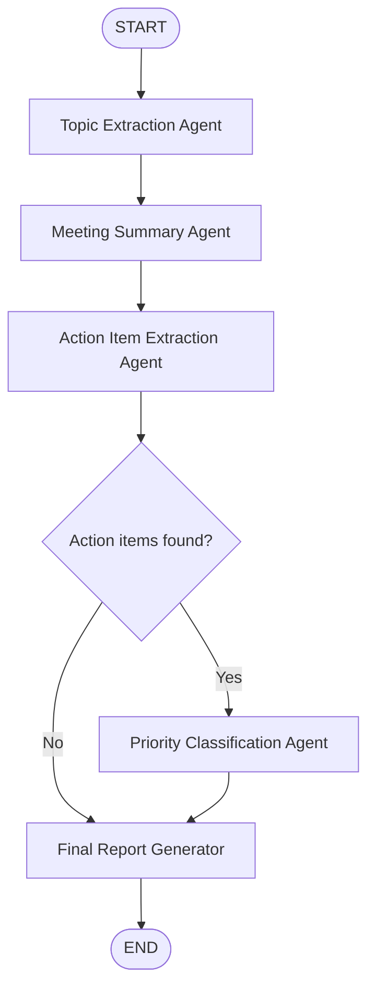

# AI Meeting Notes Analyzer

**An AI-powered meeting intelligence dashboard built with LangGraph, LangChain, OpenAI, and Streamlit.**

Turn meeting transcripts into concise summaries, discussion topics, actionable follow-ups, and prioritized task lists in one workflow. The Streamlit interface uses a Microsoft Teams-inspired purple palette and provides downloadable reports.

## Features

- **Transcript input:** Upload a `.txt` transcript or paste/edit transcript text directly in the app.
- **Meeting summary:** Generate a factual, concise 3–5 sentence summary.
- **Topic extraction:** Identify key discussion themes.
- **Action items:** Extract tasks, responsible owners, stated deadlines or triggers, and supporting transcript evidence.
- **Priority classification:** Categorize tasks as **High**, **Medium**, or **Low**.
- **Conditional routing:** Skip priority classification when no action items are found.
- **Interactive dashboard:** View analysis statistics and filter tasks by owner or priority.
- **Report downloads:** Export the results as **Markdown** or **JSON**.
- **Configurable model:** Select `gpt-4o-mini` (default) or `gpt-4o` in the app.

## Tech Stack

| Component | Technology |
| --- | --- |
| Web interface | Streamlit |
| Agent orchestration | LangGraph |
| LLM integration | LangChain / `langchain-openai` |
| Language models | OpenAI `gpt-4o-mini` / `gpt-4o` |
| Structured output | Pydantic |
| Configuration | `python-dotenv` locally; Streamlit Secrets when deployed |
| Language | Python 3.12 (development environment) |

## LangGraph Architecture



The workflow maintains a shared `MeetingState` containing the transcript and generated outputs. Four specialized LLM-powered agents extract topics, summarize the discussion, identify actions, and assign priorities. A Python report node formats the results without an additional LLM call.

## Repository Structure

```text
ai-meeting-notes-analyzer/
├── app.py                    # Streamlit UI and LangGraph workflow
├── code.ipynb                # Development notebook
├── Meeting_Transcript.txt    # Sample transcript
├── requirements.txt          # Python dependencies
├── .gitignore                # Excludes local secrets and virtual environment
└── README.md                 # Project documentation
```

## Run Locally

### 1. Clone the repository

```bash
git clone https://github.com/Nakul-GitH/ai-meeting-notes-analyzer.git
cd ai-meeting-notes-analyzer
```

### 2. Create and activate a virtual environment

Windows Command Prompt:

```cmd
python -m venv myenv
myenv\Scripts\activate
```

### 3. Install dependencies

```cmd
python -m pip install -r requirements.txt
```

### 4. Configure your OpenAI API key

Create a file named `.env` in the project root:

```dotenv
OPENAI_API_KEY=your_openai_api_key_here
```

**Never commit `.env` or expose your API key in the repository.** The project's `.gitignore` excludes `.env` and `myenv/`.

### 5. Launch Streamlit

```cmd
python -m streamlit run app.py
```

Open the local URL shown in the terminal (typically `http://localhost:8501`).

## How to Use

1. Open the application.
2. Upload a `.txt` meeting transcript or paste its contents into the transcript editor.
3. Choose an OpenAI model in the sidebar.
4. Click **Analyze meeting**.
5. Review the summary, key topics, priority distribution, and action items.
6. Filter action items by owner or priority and inspect supporting evidence.
7. Download the Markdown or JSON report.

The app requires an internet connection and an OpenAI API key with access to the selected model. OpenAI API usage may incur charges.

## Example Project Scenario

The included `Meeting_Transcript.txt` discusses a mobile application crashing during login, particularly for Android users. The meeting covers potential authentication API changes, debugging, testing, customer communication, and a possible patch release.

During notebook development, the team built a **17-action-item manually reconciled reference**. One end-to-end notebook run completed in **16.33 seconds**, identifying **8 topics and 17 action items**, with a priority distribution of **4 High, 12 Medium, and 1 Low**. These numbers describe that particular test run, **not guaranteed app output or a formal accuracy benchmark**; LLM results can vary.

## Deployment on Streamlit Community Cloud

1. Push your project files to GitHub.
2. In [Streamlit Community Cloud](https://share.streamlit.io/), create an app from the repository.
3. Choose the `main` branch and set the main file path to `app.py`.
4. In **Advanced settings → Secrets**, add:

   ```toml
   OPENAI_API_KEY = "your_openai_api_key_here"
   ```

5. Deploy the app and test it with a sample transcript.

**Security:** Use Streamlit Secrets for deployment; do not upload `.env` or paste your real API key into source code, screenshots, or the README.

## Limitations and Future Improvements

- Action extraction and priority classification are **LLM-generated** and may occasionally omit tasks, merge or split related actions, or assign an incorrect owner or deadline.
- Deadlines are captured from transcript language and are **not automatically converted into calendar events**.
- Report content should be reviewed before it is used to assign real-world responsibilities.
- The current app accepts plain-text (`.txt`) transcripts; it does not transcribe audio or video.
- Potential improvements include a dedicated validation agent, stable action IDs, broader evaluation datasets, and support for additional file formats.

## Author

**Nakul Gupta**  
GitHub: [Nakul-GitH](https://github.com/Nakul-GitH)

---

*Developed as a Generative AI / Agentic AI project demonstrating multi-agent orchestration with LangGraph.*
